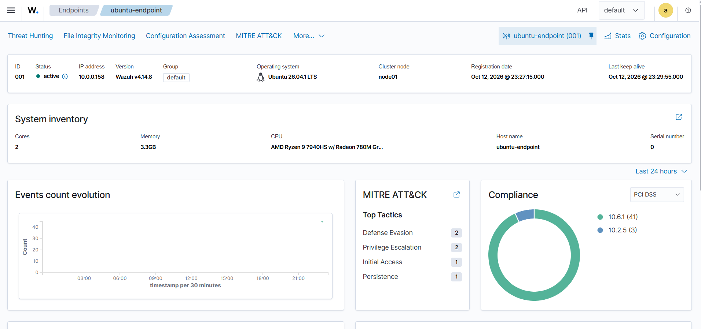
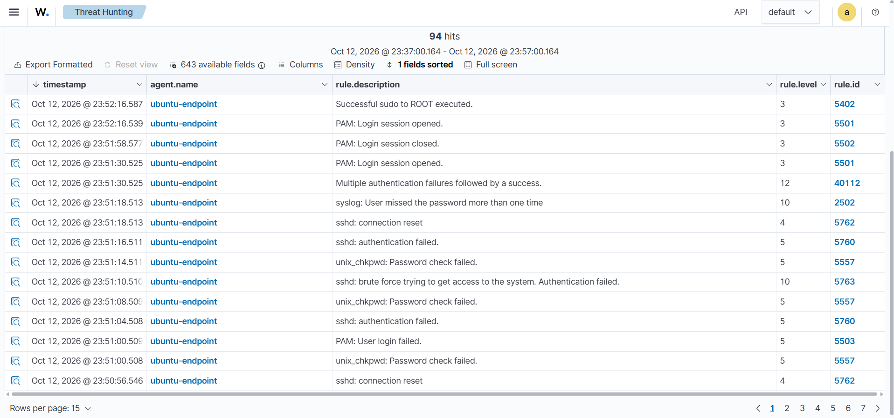
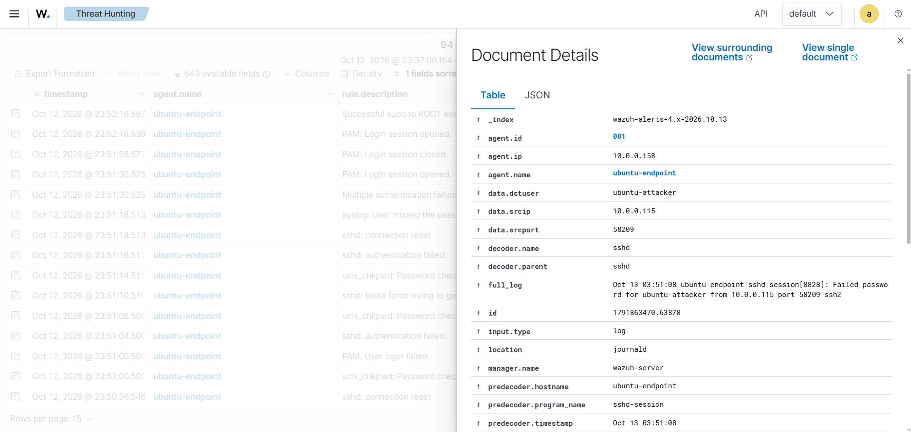
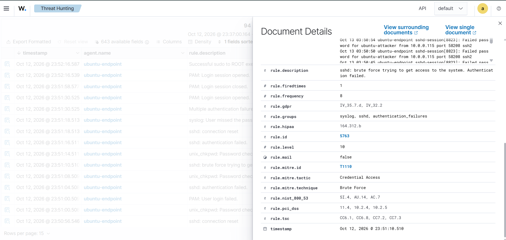
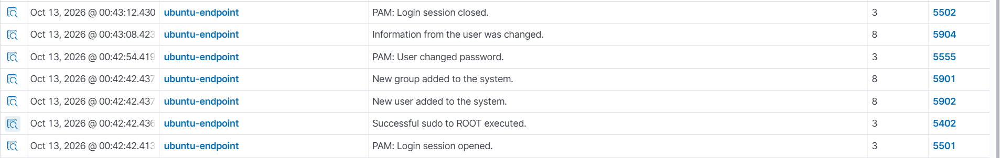
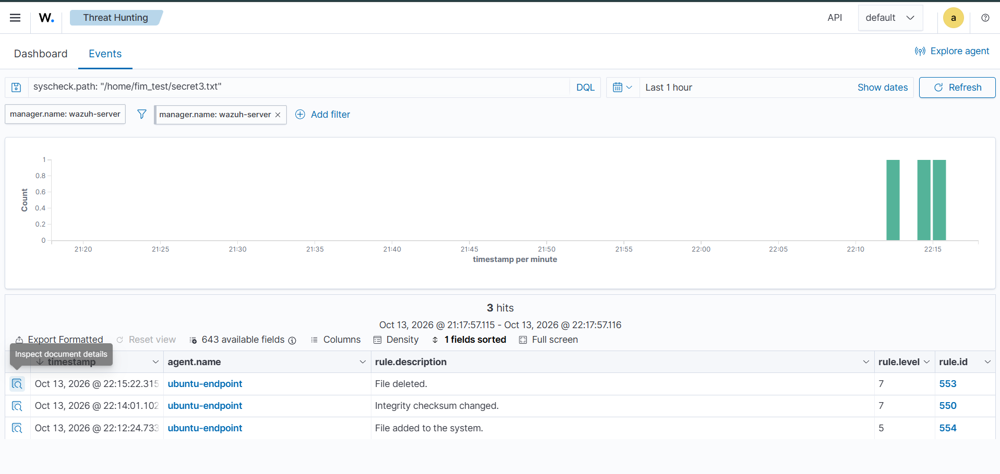
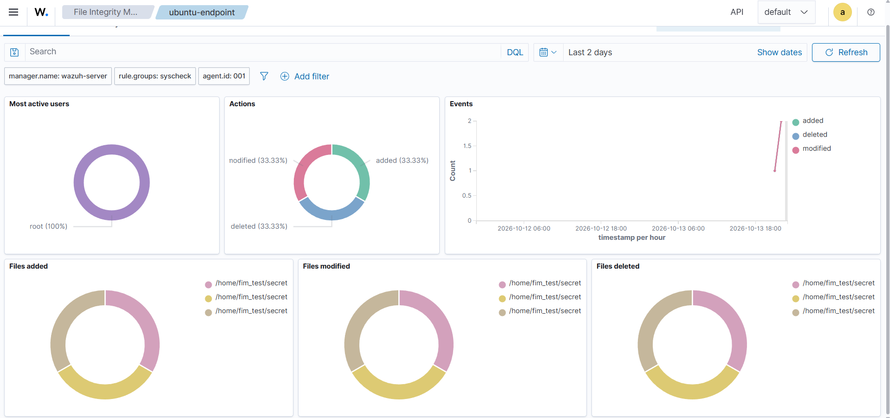
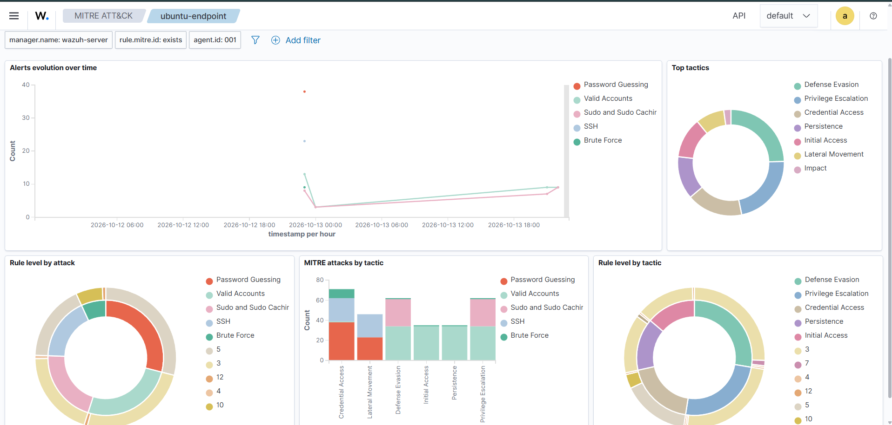

# SIEM-Homelab

## Overview
- I built a small practice network using two virtual machines (VMs) in VirtualBox, with my laptop's command prompt acting as the attacker.
- This was my first cybersecurity project, and I was new to most of the tools I used. I used Claude LLM to guide me through the process while I ran the commands, generated the attacks, and analyzed and logged all of my findings.
- My goal was to gain hands on experience in cybersecurity beyond my coursework, specifically learning how a SIEM detects attacks and how to read its alerts. I learn best by doing, so this was a great starting project for me.


## Architecture
```
Attacker (Windows laptop)
   | runs the SSH login attempts
   v
Ubuntu VM (victim, runs Wazuh agent)
   | sends logs and file events
   v
Wazuh VM (manager + dashboard)
   | analyzes events and raises alerts
   v
Me, investigating the alerts in the dashboard
```

- **Wazuh VM:** the "security guard." It collects logs from other devices and raises alerts when something looks suspicious. This kind of tool is called a SIEM (Security Information and Event Management).
- **Ubuntu VM:** the "victim" computer being watched. The Wazuh agent on it reads its logs and watches files, then sends them to the Wazuh VM.
- **Windows laptop:** the "attacker," used to simulate attacks on the Ubuntu VM.
- **Networking:** the Ubuntu VM has two adapters, NAT for internet access and Bridged for lab traffic between the machines.
  
## Tools Used
- **Wazuh:** open-source SIEM (manager and dashboard) that collects logs and raises alerts
- **Ubuntu:** the monitored endpoint, running the Wazuh agent and an SSH server
- **VirtualBox:** runs both VMs on my laptop
- **SSH and Windows Command Prompt:** used to simulate the attacks
- **MITRE ATT&CK:** framework Wazuh uses to tag alerts by attacker technique
  
## What I Did
| Step | Activity | Result |
|------|----------|--------|
| 1 | Deployed the Wazuh agent on the Ubuntu VM | Agent showed Active in the dashboard |
| 2 | Ran repeated failed SSH logins from my laptop | Brute force alert (rule 5763, level 10) |
| 3 | Created a new user account on the Ubuntu VM | New user alert (rule 5902, level 8) |
| 4 | Created, modified, and deleted a file in a monitored folder (File Integrity Monitoring, FIM) | File added (rule 554, level 5), checksum changed (rule 550, level 7), file deleted (rule 553, level 7) |

## Findings
### 1. Agent Deployment
- **What I did:** Installed the Wazuh agent on the Ubuntu VM using the dashboard's Deploy new agent command
- **What Wazuh showed:** Agent Name: ubuntu-endpoint | Status: active
- **What it means:** The agent is basically the eyes and ears of the SIEM, without it being installed the SIEM has no way of watching an endpoint. Its like owning a camera without the camera being installed.


### 2. SSH Brute Force
- **What I did:** Ran several unsuccessful SSH attempts from my attacking device to the victim machine, triggering several alerts in the SIEM
- **What Wazuh showed:**  `sshd: brute force trying to get access to the system. Authentication failed` | rule.id: 5763 | Level: 10
- **Key fields I read:** Source ip: 10.0.0.115 | Agent name: ubuntu-endpoint | MITRE tag: T1110
- **What it means:** The alert shows repeated failed logins from one IP, which is consistent with password guessing




### 3. Sudo and New User
- **What I did:** I created a new user account named `testattacker` on the Ubuntu VM using `sudo adduser`.
- **What Wazuh showed:** The single command produced a chain of alerts: a login session opened (rule 5501, level 3), a successful sudo to root (rule 5402, level 3), a new user added (rule 5902, level 8), a new group added (rule 5901, level 8), a password change (rule 5555, level 3), user information changed (rule 5904, level 8), and a login session closed (rule 5502, level 3).
- **Key fields I read:** Username created: `testattacker` | Agent: `ubuntu-endpoint` | Timestamp: Oct 13, 2026 @ 00:42:42
- **What it means:** The routine sudo and session alerts are level 3, while the account changes are level 8, so severity shows which alerts to look at first. Sudo alerts are mostly normal noise, since admins use sudo constantly. An unexpected new account is more concerning, because attackers create accounts to keep access to a machine. Wazuh raised these as separate alerts, so an analyst has to connect them by username and timestamp.


### 4. File Integrity Monitoring
- **What I did:** Added a monitored folder to the agent configuration, then created, modified, and deleted files within the folder.
- **What Wazuh showed:** There were three alerts, one for each event. | `File added to the system` - rule.id: 554 - rule.level: 7 | `Integrity checksum changed` - rule.id: 550 - rule.level: 7 | `File deleted` - rule.id: 553 - rule.level: 7 |
- **Key fields I read:** file path: /home/fim_test/secret.txt | Event types: added, modified, deleted | MITRE techniques: Stored Data Manipulation (modified file), File Deletion and Data Destruction (deleted file)
- **What it means:** Wazuh detected the change by comparing the file's checksum (unique value - like a digital fingerprint) before and after the edit. FIM is used to catch tampering with important files, like system configs, and the MITRE tags show why that matters: modifying or deleting files can be part of hiding an attack or destroying data.



### 5. MITRE ATT&CK Overview
- **What I did:** I opened the MITRE ATT&CK module in the Wazuh dashboard for the `ubuntu-endpoint` agent and set the time range to cover both days of the lab (Oct 12 to 13).
- **What Wazuh showed:** The alerts matched several MITRE techniques, including Brute Force, Password Guessing, SSH, Valid Accounts, and Sudo and Sudo Caching. These fell under tactics such as Credential Access, Defense Evasion, Privilege Escalation, Persistence, Initial Access, and Lateral Movement.
- **What it means:** MITRE ATT&CK is a catalog of known attacker tactics and techniques, and Wazuh tags alerts with it so an analyst can see what kind of behavior each alert represents. My failed logins mapped to Brute Force and Password Guessing, my successful login to Valid Accounts, and my sudo commands to Sudo and Sudo Caching. A single technique can belong to several tactics, so one login can count toward several charts, which is why some tactics look larger than what I actually did.

## Problems I Solved
## What I Learned
## Next Steps
